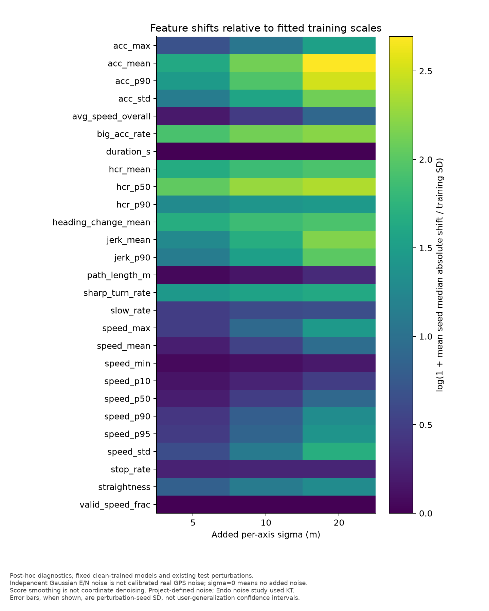
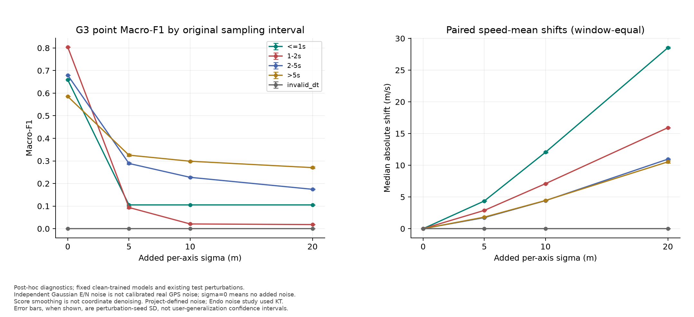
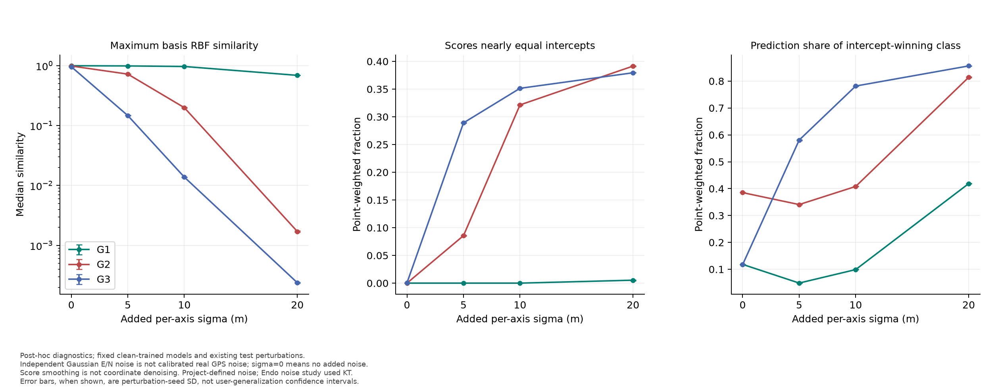
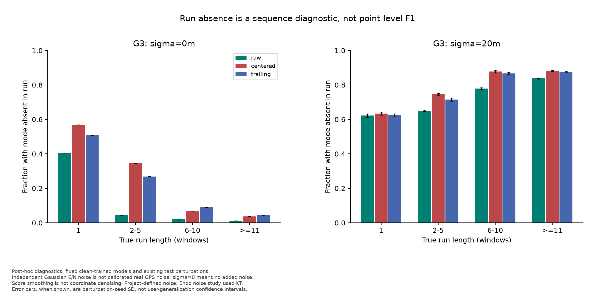
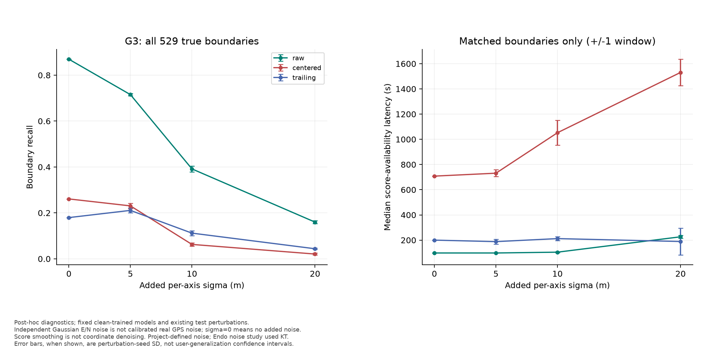
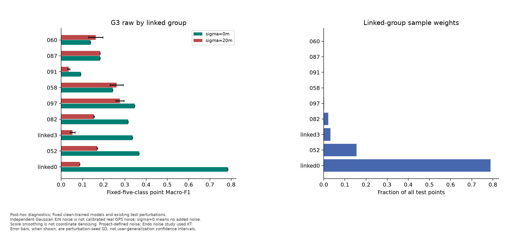

# GeoLife 噪声鲁棒性补充诊断

日期：2026-11-23。性质：固定实验完成后的事后描述性分析，不是新注册实验，也不是模型选择。

## 结论摘要

1. 已完成特征与采样间隔、冻结 RBF 表示、平滑的短模式代价、用户组与类别差异四条诊断。所有主实验文件保持不变，没有训练新模型。
2. 定位扰动伴随运动特征明显偏移，G3 的有限基点 RBF 相似度和映射范数下降，并出现接近截距的决策分数及类别集中。这支持一个部分失效机制，不证明全部错误由它造成。
3. 居中平滑能提高无附加噪声时的点级 Macro-F1，但真实边界召回明显降低。短模式是否被抹除必须单独计数，不能仅凭曲线更平滑宣称鲁棒性改善。
4. 最大关联用户组 linked0 占 78.8832% 测试点。G3 与 G2 的退化差异的配对用户区间跨零，不能据此宣布谁普遍更抗噪。

## 1. 保持不变的实验与核验

- 测试集：13 用户、9 关联用户组、860,972 点、17,380 个固定窗口；50 点窗口及原尾窗合并、block 和标签规则均保留。
- 读取现有 16 份特征缓存、48 份原始预测及 48 份平滑预测；无坐标重扰动、无特征重生成、无删点、无 G4。
- 模型仍为原 G1/G2/G3，训练使用 clean，测试坐标使用原固定 E/N 独立高斯噪声。sigma 是单轴标准差，水平 RMS 为 sigma × sqrt(2)。
- 重建全部 834,240 个模型-条件-窗口的冻结 decision 分数，容差为绝对 1e-7；预测标签逐窗完全一致。
- 144 行点级指标、48 行 G3 边界指标与主结果核对一致；36 行 bootstrap 汇总使用原 5000×9 重采样矩阵复现。
- 分析前后对 282 个原始输入及主产物文件做 SHA-256 核验，变化数为 0。交付时另做独立复核。
- 7 项单元测试覆盖采样分箱边界、256 种二分匹配例、因果支持区间、固定五类计分、混合标签窗口点计分和短模式分母。

所有“±”都是 5 个扰动种子的样本标准差，sigma=0 仅有一份，不是 5 次独立实验。bootstrap 区间在第 6 节单列。

### 主实验 raw 结果保留

| 特征组 | sigma/m | Macro-F1：种子均值 ± SD | 相对自身 sigma=0 的下降 |
| --- | --- | --- | --- |
| G1 | 0 | 0.6983 | 0.0000 |
| G1 | 5 | 0.2737 ± 0.0011 | 0.4246 |
| G1 | 10 | 0.2121 ± 0.0021 | 0.4862 |
| G1 | 20 | 0.1274 ± 0.0011 | 0.5709 |
| G2 | 0 | 0.7163 | 0.0000 |
| G2 | 5 | 0.2228 ± 0.0015 | 0.4935 |
| G2 | 10 | 0.1763 ± 0.0006 | 0.5400 |
| G2 | 20 | 0.1539 ± 0.0016 | 0.5624 |
| G3 | 0 | 0.7788 | 0.0000 |
| G3 | 5 | 0.2245 ± 0.0031 | 0.5543 |
| G3 | 10 | 0.1629 ± 0.0009 | 0.6159 |
| G3 | 20 | 0.1370 ± 0.0009 | 0.6418 |

## 2. 特征偏移与采样间隔

下表每个条件先在窗口间取中位数，再对 5 个种子取均值。不是点加权均值，也不是先混合全部种子。最后一列是“逐窗配对绝对变化 / 训练集已拟合尺度”的中位数再取种子均值，不能与前两列中位数之差混淆。速度单位 m/s，加速度 m/s²，jerk m/s³，比例与 straightness 无量纲。

| 特征 | 无附加噪声中位数 | sigma=5 中位数 | sigma=20 中位数 | sigma=20 配对绝对偏移/训练尺度 |
| --- | --- | --- | --- | --- |
| speed_mean | 3.30474 | 6.80615 | 19.33341 | 1.6235 |
| speed_p90 | 5.08838 | 12.06556 | 32.86992 | 2.6961 |
| acc_mean | 0.32864 | 1.88800 | 5.34637 | 13.7919 |
| acc_p90 | 0.70523 | 3.83992 | 10.93998 | 11.3406 |
| jerk_mean | 0.26585 | 1.68543 | 4.55171 | 7.8640 |
| stop_rate | 0.06000 | 0.00000 | 0.00000 | 0.3204 |
| straightness | 0.88322 | 0.42595 | 0.12716 | 2.6749 |

按无附加噪声的原始 `dt_mean` 做事后分层，仅用于描述；没有把采样间隔加入模型输入，也没有按噪声重新划分窗口。每层仍按固定五类点级 Macro-F1 计分。

| dt_mean | 窗口数 | 点数 | G3 raw F1：0m | G3 raw F1：20m | 20m 减 0m |
| --- | --- | --- | --- | --- | --- |
| 1-2s | 7714 | 384665 | 0.8037 | 0.0182 ± 0.0000 | -0.7855 |
| 2-5s | 4661 | 232317 | 0.6793 | 0.1743 ± 0.0017 | -0.5050 |
| >5s | 1467 | 68216 | 0.5854 | 0.2703 ± 0.0036 | -0.3150 |
| invalid_dt | 17 | 17 | 0.0000 | 0.0000 ± 0.0000 | +0.0000 |
| <=1s | 3521 | 175757 | 0.6588 | 0.1052 ± 0.0000 | -0.5536 |

解释边界：相同位置扰动经过距离和时间差运算可能对高频采样产生较强影响，但各层同时具有不同用户、类别和运动状态构成，不能将层间差异当作采样间隔的因果效应。真实 GPS 误差还可能存在时序相关；本实验未进行真实误差标定。距离高估的理论条件及相应文献见 SOURCES.md。

## 3. 冻结 RBF 表示与预测集中

RBF 采用 `exp(-gamma * squared_distance)`。诊断使用训练时冻结的填补器、标准化器、1000 个 Nystroem 基点、归一化矩阵与分类器，不对测试集重新拟合。

G3 截距从大到小为：train=-0.204750、walk=-0.390669、bike=-0.677729、bus=-0.740783、car=-0.776332。

| sigma/m | 最大基点相似度中位数 | 映射 L2 范数中位数 | 近截距分数点占比 | 截距赢家预测点占比 |
| --- | --- | --- | --- | --- |
| 0 | 0.960312 | 0.999644 | 0.0429% | 11.7409% |
| 5 | 0.146925 | 0.243897 | 28.9114% ± 0.0717% | 58.0615% ± 0.1593% |
| 10 | 0.0138036 | 0.0203909 | 35.1459% ± 0.0318% | 78.1644% ± 0.0928% |
| 20 | 0.000238124 | 0.000267496 | 37.9489% ± 0.0385% | 85.6532% ± 0.0634% |

“近截距”仅是诊断标记：五类分数与各自截距的最大绝对差不超过 1e-6，不改变预测规则。相似度和范数是窗口中位数再做种子均值；后两列按真实窗口点数加权。该相似度只针对冻结的 1000 个基点，不代表与全部训练样本的最近相似度。decision 分数不是概率。

可支持的解释是：特征分布偏移与 RBF 表示衰减、截距主导决策同时出现。不能把全部 G3 失败归因于 jerk 或转向，也不能从这组观察中推出某个新 gamma、去噪方法或模型会更好；本轮没有做这些实验。

## 4. 平滑的分类收益与短模式代价

无附加噪声时 G3 的分类与边界表现：

| 处理 | 点级 Macro-F1 | 错误孤立跳变/100窗口 | 切换 Recall | 切换 F1 | 匹配真实边界 | 漏掉边界 | 已匹配边界分数可用延迟中位数/s |
| --- | --- | --- | --- | --- | --- | --- | --- |
| 原始分数 | 0.7788 | 3.8262 | 0.8696 | 0.2596 | 460/529 | 69 | 98.0 |
| 居中 soft k=11 | 0.8443 | 0.1151 | 0.2609 | 0.2754 | 138/529 | 391 | 708.0 |
| 因果 trailing soft k=11 | 0.8022 | 0.1841 | 0.1796 | 0.1546 | 95/529 | 434 | 200.0 |

边界仍按 block 内 ±1 窗口、一对一最大数量匹配，且不约束切换类别方向。方向是否正确单列在逐边界表中，不偷换主评价定义。

### 短模式是否被完全抹除

真实 run 是同一个原 block 内连续的窗口多数标签。“模式缺失”指该 run 内没有任何预测窗口给出这个真实模式，不是点级召回率。下表使用 sigma=0，避免把原始噪声错误误认为平滑新增损失：

| 真实长度/窗口 | 处理 | 真实 run 数 | 模式缺失数 | 模式缺失率 | 新增缺失/原始至少命中一次 | 原始全对后缺失/原始全对 |
| --- | --- | --- | --- | --- | --- | --- |
| 1 | 原始分数 | 394 | 160 | 40.61% | 0/234 | 0/234 |
| 1 | 居中 soft k=11 | 394 | 224 | 56.85% | 64/234 | 64/234 |
| 1 | 因果 trailing soft k=11 | 394 | 200 | 50.76% | 40/234 | 40/234 |
| 2-5 | 原始分数 | 484 | 22 | 4.55% | 0/462 | 0/291 |
| 2-5 | 居中 soft k=11 | 484 | 168 | 34.71% | 146/462 | 65/291 |
| 2-5 | 因果 trailing soft k=11 | 484 | 130 | 26.86% | 109/462 | 52/291 |
| 6-10 | 原始分数 | 304 | 7 | 2.30% | 0/297 | 0/120 |
| 6-10 | 居中 soft k=11 | 304 | 21 | 6.91% | 14/297 | 0/120 |
| 6-10 | 因果 trailing soft k=11 | 304 | 27 | 8.88% | 20/297 | 2/120 |
| >=11 | 原始分数 | 556 | 6 | 1.08% | 0/550 | 0/139 |
| >=11 | 居中 soft k=11 | 556 | 20 | 3.60% | 14/550 | 0/139 |
| >=11 | 因果 trailing soft k=11 | 556 | 25 | 4.50% | 19/550 | 0/139 |

sigma=20 的面板反映“噪声与固定平滑共同作用后的模式缺失”，不能全部算作平滑造成。其新增缺失和原始全对子集的严格分母见 `run_length_summary.csv`。另按真实持续秒数分层，避免把短窗口序列直接等同于短时间。

### 11 个窗口实际意味着多长时间

| 处理 | 支持跨度中位数/s | 支持跨度 P90/s | 额外未来等待中位数/s | 额外未来等待 P90/s |
| --- | --- | --- | --- | --- |
| 原始分数 | 98.0 | 245.0 | 0.0 | 0.0 |
| 居中 soft k=11 | 1080.0 | 2409.0 | 500.0 | 1205.0 |
| 因果 trailing soft k=11 | 912.0 | 2224.1 | 0.0 | 0.0 |

支持跨度为首个纳入窗口起点到末个纳入窗口终点。额外未来等待相对于当前窗口完成时刻；trailing 为 0，但仍必须等待当前窗口的数据，不代表系统零延迟。居中是离线方案，最多读取 5 个未来窗口；trailing 只读当前及历史窗口。

时间误差和分数最早可用延迟仅对成功匹配的边界统计；最大数量匹配不保证最小时间误差。漏检可能很多，因此不能把图中的条件延迟推广到全部真实切换，更不能把少量匹配下较低延迟解释为整体更好。

### 连续错误补表

| sigma/m | 处理 | 错误 run 数 | 每条件错误长度中位数再均值/窗口 | 错误时长中位数再均值/s | 每条件最大错误时长再均值/s |
| --- | --- | --- | --- | --- | --- |
| 0 | 原始分数 | 1683.0 | 1.00 | 166.0 | 12031.0 |
| 0 | 居中 soft k=11 | 748.0 | 2.00 | 374.5 | 12031.0 |
| 0 | 因果 trailing soft k=11 | 870.0 | 2.00 | 418.5 | 12031.0 |
| 20 | 原始分数 | 1197.6 | 6.10 | 1011.7 | 17300.0 |
| 20 | 居中 soft k=11 | 1024.8 | 9.00 | 1210.8 | 19981.0 |
| 20 | 因果 trailing soft k=11 | 1051.2 | 8.40 | 1181.2 | 19981.0 |

此处的连续错误使用窗口多数标签，与点级 Macro-F1 的真值粒度不同，仅作序列诊断。平均最大时长不是全条件最大值。

## 5. 用户组与类别异质性

| 关联组 | 用户 | 点数 | 测试点占比 | G3 raw F1：0m | G3 raw F1：20m | 20m 减 0m |
| --- | --- | --- | --- | --- | --- | --- |
| linked0 | 069,126,129,167 | 679162 | 78.88% | 0.7845 | 0.0874 ± 0.0006 | -0.6971 |
| 052 | 052 | 133174 | 15.47% | 0.3669 | 0.1702 ± 0.0022 | -0.1967 |
| linked3 | 089,144 | 27298 | 3.17% | 0.3359 | 0.0538 ± 0.0116 | -0.2821 |
| 082 | 082 | 18077 | 2.10% | 0.3157 | 0.1544 ± 0.0022 | -0.1613 |
| 097 | 097 | 1511 | 0.18% | 0.3460 | 0.2767 ± 0.0190 | -0.0693 |
| 058 | 058 | 911 | 0.11% | 0.2429 | 0.2615 ± 0.0308 | +0.0186 |
| 091 | 091 | 703 | 0.08% | 0.0921 | 0.0360 ± 0.0051 | -0.0561 |
| 087 | 087 | 119 | 0.01% | 0.1836 | 0.1836 ± 0.0000 | +0.0000 |
| 060 | 060 | 17 | 0.00% | 0.1385 | 0.1631 ± 0.0337 | +0.0246 |

去掉最大关联组后的描述性敏感性结果：G3 raw 无附加噪声 F1 为 0.5275，20m 为 0.3106 ± 0.0047。这是同一模型对现有子集的计分，不是新划分或重新训练，不能替代主结果。

各组类别覆盖不同。固定五类 Macro-F1 会对缺失类别记 0，组间低分未必完全来自识别更差，因此需要结合类别支持数和组内配对变化解释。逐用户和逐组值分别保留，不把 13 个用户当作 13 个独立关联组。

G3 raw 的全测试集类别结果：

| 类别 | 真实点数 | F1：0m | F1：20m | 20m 预测点占比 |
| --- | --- | --- | --- | --- |
| walk | 309175 | 0.8631 | 0.3156 ± 0.0014 | 11.9531% ± 0.0571% |
| bike | 192185 | 0.8415 | 0.0124 ± 0.0006 | 0.1601% ± 0.0076% |
| bus | 211313 | 0.7304 | 0.1225 ± 0.0034 | 2.0380% ± 0.0506% |
| car | 61011 | 0.6119 | 0.0229 ± 0.0020 | 0.1957% ± 0.0160% |
| train | 87288 | 0.8473 | 0.2116 ± 0.0001 | 85.6532% ± 0.0634% |

## 6. 用户不确定性与不可宣称的结论

下表为 9 个关联用户组的 5000 次配对 bootstrap 百分位区间。对每次用户抽样分别计算各种子的 F1，再对种子取均值，不先平均混淆矩阵。变化定义为 noisy 减 clean，负数代表下降：

| 特征组 | sigma/m | Macro-F1 的 95% 区间 | 相对自身 clean 变化的 95% 区间 |
| --- | --- | --- | --- |
| G1 | 0 | [0.2785, 0.7135] | [+0.0000, +0.0000] |
| G1 | 20 | [0.0598, 0.3021] | [-0.6055, -0.0138] |
| G2 | 0 | [0.2987, 0.7331] | [+0.0000, +0.0000] |
| G2 | 20 | [0.0732, 0.2277] | [-0.6130, -0.1773] |
| G3 | 0 | [0.3502, 0.8001] | [+0.0000, +0.0000] |
| G3 | 20 | [0.0898, 0.3640] | [-0.7052, -0.0928] |

G3 减 G2 的 raw 配对变化差为 -0.079430，95% 区间 [-0.098176, +0.139658]，跨越 0。这里的差是 `(G3 noisy-clean) - (G2 noisy-clean)`，不是两个噪声分数的直接差。没有证据据此宣布总体抗噪排名，也不能把基线较低而下降较少当作更强。

独立用户组只有 9 个且权重高度不均，区间可能较宽；其可信度受这些数据和重采样假设限制。新增分层和诊断阈值均为事后描述，不提供未校正多重检验的“显著性”结论。

## 7. 可直接用于课程报告的表述

> 在固定 clean-training/noisy-test 协议下，额外独立定位扰动使运动特征分布偏移，并伴随冻结 RBF 表示衰减及类别预测集中。分数平滑在无附加噪声条件下改善点级分类，但同时减少真实切换的检出，并可能完全抹除短模式。点级 F1、真实边界保留与可用延迟因而需要共同报告。上述解释属于现有测试样本上的事后机制证据，不构成真实 GPS 场景或模型抗噪排名的普遍结论。

建议正文以“性能退化、特征偏移、表示变化、平滑代价”为四段主线；用户组与类别表以及条件延迟放入结果解释或附录。不要新增未经批准的噪声模型、坐标滤波、gamma 调优或训练增强。

## 8. 交付入口

- [文献与软件核查](SOURCES.md)，包含原文范围、可引用内容和不可外推的结论。
- [分析规范](ANALYSIS_SPEC.md)。
- 完整运行的 `window_diagnostics/` 含 48 份逐窗 RBF 诊断 Parquet，操作入口为 [analyze.py](analyze.py)。
- [诊断汇总 CSV](tables/)，包含各条件、类别、用户组、短模式和切换边界的汇总结果。
- [六图的 PNG 与矢量 PDF](figures/)。
- [运行核验](audit.json)、[交付独立复核](delivery_audit.json)、[图表视觉检查](VISUAL_QA.md)。

研究流程使用 Scientific Agent Skills 的 scientific-critical-thinking 辅助检查抽样单位、证据边界和事后解释，已在 SOURCES.md 的软件与流程部分注明。它不替代数值验收。
