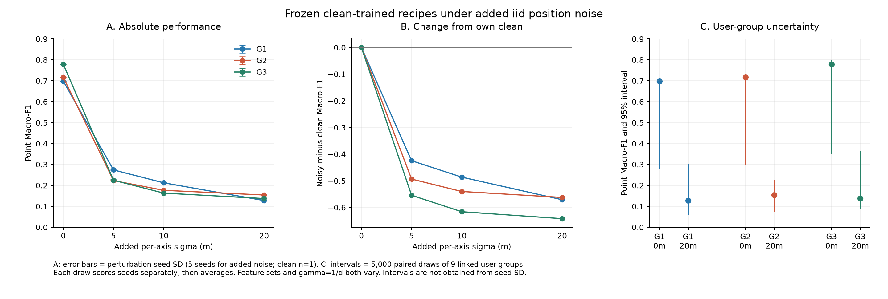
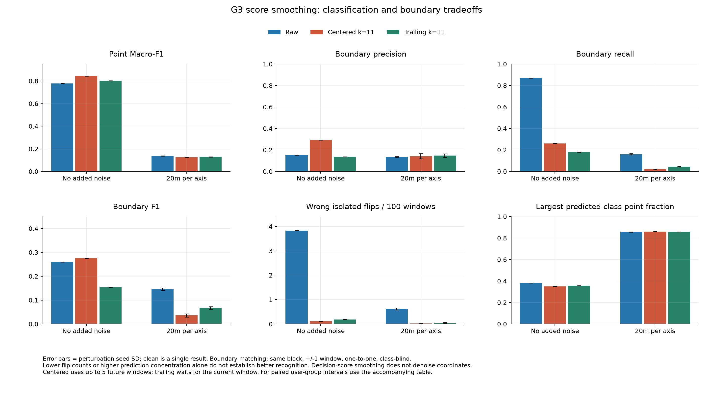
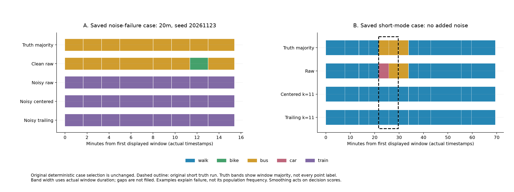

# GeoLife 噪声、特征组合与平滑：修订分析草稿

2026-11-23。供团队核对、改写和引用，尚非最终提交稿。本轮使用既有结果完成展示修订与描述性补充；固定协议、模型、随机数、特征和主指标均沿用。

## 1. 研究问题与协议

本研究回答三个问题：冻结模型对额外定位扰动有多敏感；三种预定特征配方表现如何；分数平滑对点级分类与切换识别分别产生什么影响。

数据为 GeoLife 已处理轨迹的五类方式：walk、bike、bus、car、train。原用户划分为51个训练用户、13个测试用户；沿用标签切窗、短窗筛选后，49个训练用户贡献70,086个拟合窗口。测试保留全部13用户、860,972点、17,380窗。划分中的51与参与拟合的49是不同分母；没有删除测试用户或重新划分。

采用原50点窗口、block及尾窗合并规则。模型只在clean训练集拟合；每个测试坐标的E/N轴添加逐点独立高斯扰动，单轴σ为0、5、10、20m，水平RMS为√2σ。σ=0仅表示无附加扰动。非零档位使用固定五个种子20261123–20261127，同一种子跨σ共享标准正态场；三组特征共享坐标，共16份特征缓存。所有运动量从扰动坐标重新计算；超速间隔保留并记录。

G1有10维速度及stop/slow统计；G2有15维，加入加速度统计；G3保留原v2的27维。各组分别拟合中位数填补、标准化、1000维Nystroem RBF与balanced LinearSVC，C=1、seed=42、gamma=1/d，之后冻结。G4跳过。完整定义见[协议表](tables/protocol_clarified.csv)和[冻结配置](../protocol.json)。

因此G1/G2/G3比较的是预定配方，同时改变了输入集合与gamma，不能将差异单独归因于jerk、转向或特征数量。也不据测试结果选出新的模型或参数。

S0使用raw分数；S1在同block内做居中soft k=11平均，最多使用5个未来窗口；S2使用当前及历史窗口做trailing soft k=11平均。它们处理decision分数，分数不是校准概率，处理过程也不是GPS坐标去噪。S2仍需等当前窗口完成。

## 2. 指标与不确定性

点级Accuracy、逐类别F1与固定五类Macro-F1通过每窗cnt_*真实点数计分，不把整窗全部点改成多数标签。点加权的噪声前后预测变化比例也保留。

切换真值采用窗口多数标签，同user/block内±1窗口、一对一最大数量匹配，不要求切换类别方向正确（class-blind）。报告Precision、Recall、F1与错误孤立跳变/100窗口。原segment_metrics是不同匹配规则，只在旧附表保留。

五个种子仅衡量扰动波动，非零σ报告样本SD；clean只有一份，CSV中的SD=0是存储约定，不能解释为五次重复且没有不确定性。用户区间使用原5000×9关联组配对bootstrap矩阵，每次先逐种子计分再平均；种子SD与用户区间分开呈现。最大关联组占78.8832%测试点，独立组少且大小悬殊，限制区间的推广解释。

所有配对差均复用同次抽样，不能通过两个独立区间相减获得。新增描述分析不作多重比较校正后的显著性排名。原Part2部分用户/bootstrap F1平均出现类别，本研究始终固定五类，二者区间不混用。

边界区间按每次抽样合计的匹配/预测/真实边界计数计算，不平均用户比率。原5000次抽样中有133次没有真实边界，分母为零时沿用主实现的0计分；这可能影响区间，不能将其解释为普遍实时切换能力的保证。该约定及计数见[既有配对分析验收](../paired_analysis/acceptance.json)。

## 3. 定位扰动与特征配方

| 组 | 单轴σ/m | raw F1均值±种子SD | noisy−clean | 用户组95%区间 |
| --- | --- | --- | --- | --- |
| G1 | 0 | 0.6983（单份） | +0.0000 | [0.2785, 0.7135] |
| G1 | 5 | 0.2737 ± 0.0011 | -0.4246 | [0.2043, 0.3099] |
| G1 | 10 | 0.2121 ± 0.0021 | -0.4862 | [0.0746, 0.2654] |
| G1 | 20 | 0.1274 ± 0.0011 | -0.5709 | [0.0598, 0.3021] |
| G2 | 0 | 0.7163（单份） | +0.0000 | [0.2987, 0.7331] |
| G2 | 5 | 0.2228 ± 0.0015 | -0.4935 | [0.1020, 0.2317] |
| G2 | 10 | 0.1763 ± 0.0006 | -0.5400 | [0.0354, 0.1837] |
| G2 | 20 | 0.1539 ± 0.0016 | -0.5624 | [0.0732, 0.2277] |
| G3 | 0 | 0.7788（单份） | +0.0000 | [0.3502, 0.8001] |
| G3 | 5 | 0.2245 ± 0.0031 | -0.5543 | [0.1675, 0.2941] |
| G3 | 10 | 0.1629 ± 0.0009 | -0.6159 | [0.1143, 0.3732] |
| G3 | 20 | 0.1370 ± 0.0009 | -0.6418 | [0.0898, 0.3640] |

以上为全测试集raw结果。负的noisy−clean表示退化；必须同时比较绝对分数。不能仅因某组clean较低、下降较少就认定其更鲁棒。[全条件表](tables/all_conditions.csv)包含三组、四档噪声、三种平滑的全部36行种子汇总与用户区间，源于144行原指标。

图1A误差棒为五种子SD，clean只有一份；B为相对自身clean的变化；C单列9关联组5000次配对抽样区间，避免将种子波动写成泛化置信度。图中所有条件均为附加独立位置噪声压力测试。

无附加噪声时G3的raw点估计最高；20m时G2点估计最高。不过G3−G2的20m直接F1差为−0.016913，配对区间[−0.031275,+0.227581]；相对自身clean变化的组间差为−0.079430，区间[−0.098176,+0.139658]。两者回答不同问题，现有数据不足以建立普遍抗噪排名，也不证明等效。原精度见[组间配对表](../paired_analysis/tables/paired_feature_contrasts.csv)。

### 量级与机制解释

实际有效点间隔中82.8602%不超过2s。对局部平面、静止原位、仅额外独立噪声的解析参照，平均表观速度为√πσ/Δt；σ=5m、Δt=2s时约4.4311m/s。此数只是量级说明，不是移动轨迹的实测速度预测，也不假设原坐标是真值。相邻误差增量共享位置点，不能把独立位置误差写成独立速度误差。坐标线性二/三阶差分的方差也不能直接套到本项目标量speed导出的acc/jerk。

原诊断显示speed、acc、jerk及straightness偏移，同时G3冻结的1000基点RBF相似度和映射范数下降，20m的近截距点占比约37.95%，预测train点占比约85.65%。这些现象支持部分失效机制，不能解释为所有错误都由数值下溢造成。按采样间隔的分层还受用户、类别和运动状态构成影响，不作因果解释。

解释参照也必须明确目标：always-walk的固定五类F1为0.105688、Accuracy为0.359100；G3 raw 20m约为0.137013和0.195398。其F1高于常量参照而Accuracy低于它，不能说“五类所以随机Macro-F1=0.2”。常量类别仅用于描述现有分数，不作为测试集选择出的新模型。[量级推导与常量参照](../literature_review/REVIEW_REPORT.md)保留完整限定。

## 4. 分数平滑的收益与代价

下表非零σ均先逐种子计算再平均；完整SD在CSV，表中的分类与边界指标属于不同真值粒度。

| 单轴σ/m | 平滑 | 点级F1 | Accuracy | 边界P | 边界R | 边界F1 | 错误孤立跳变/100窗 | 最大预测类别占比 |
| --- | --- | --- | --- | --- | --- | --- | --- | --- |
| 0 | Raw | 0.7788 | 0.8089 | 0.1526 | 0.8696 | 0.2596 | 3.8262 | 38.29% |
| 20 | Raw | 0.1370 | 0.1954 | 0.1346 | 0.1599 | 0.1462 | 0.6168 | 85.65% |
| 0 | Centered k=11 | 0.8443 | 0.8531 | 0.2918 | 0.2609 | 0.2754 | 0.1151 | 34.95% |
| 20 | Centered k=11 | 0.1260 | 0.1867 | 0.1415 | 0.0208 | 0.0362 | 0.0173 | 86.06% |
| 0 | Trailing k=11 | 0.8022 | 0.8044 | 0.1357 | 0.1796 | 0.1546 | 0.1841 | 35.77% |
| 20 | Trailing k=11 | 0.1289 | 0.1893 | 0.1481 | 0.0439 | 0.0676 | 0.0460 | 85.79% |

图2同时显示点级F1、边界P/R/F1、错误孤立跳变与最大预测类别占比。误差棒仅为种子SD。最大类别占比不必在不同条件下来自同一类别；高集中度、少跳变都不能单独证明识别正确。

| σ/m | 平滑−raw | 指标 | 配对差均值 | 用户组配对95%区间 |
| --- | --- | --- | --- | --- |
| 0 | S1_centered_soft_k11 minus raw | macro_f1 | +0.0654 | [+0.0254, +0.1183] |
| 0 | S1_centered_soft_k11 minus raw | transition_recall | -0.6087 | [-1.0000, +0.0000] |
| 20 | S1_centered_soft_k11 minus raw | macro_f1 | -0.0110 | [-0.0183, -0.0040] |
| 20 | S1_centered_soft_k11 minus raw | transition_recall | -0.1391 | [-0.6667, +0.0000] |
| 0 | S2_trailing_soft_k11 minus raw | macro_f1 | +0.0233 | [+0.0116, +0.0736] |
| 0 | S2_trailing_soft_k11 minus raw | transition_recall | -0.6900 | [-1.0000, +0.0000] |
| 20 | S2_trailing_soft_k11 minus raw | macro_f1 | -0.0081 | [-0.0112, +0.0032] |
| 20 | S2_trailing_soft_k11 minus raw | transition_recall | -0.1161 | [-0.7333, +0.0000] |

配对差的区间来自既有[平滑配对表](../paired_analysis/tables/paired_smoothing_contrasts.csv)，不是各自区间相减。clean下居中平滑提高点级F1，但检出的真实边界从460/529降至138/529；trailing为95/529。20m下居中与trailing的全测试集F1点估计均低于raw，不能外推clean收益。

居中clean纠正80,491点、破坏42,441点，净新增正确点38,050；trailing净减少3,833正确点。这里“纠正−破坏”是Accuracy的恒等式，不是Macro-F1加法分解。20m时居中平均净减少7,502.4正确点。完整计数及分母见[平滑纠正/破坏表](../paired_analysis/tables/smoothing_point_flows.csv)。

短模式也有独立代价：clean的一窗口真实run共有394个，模式缺失从raw的160个变成居中的224个；原raw至少命中一次的234个run中，64个被居中新增抹除。此处run基于窗口多数标签，不是点级召回率。居中支持跨度中位数1,080s，额外未来等待中位数500s；trailing额外未来等待为0，但需等待当前窗口完成。成功匹配边界的延迟受漏检选择影响，不能代表全部事件。

## 5. 补齐切换指标的时间与标签分辨率

本轮从固定clean窗口枚举所有529个真实窗口边界可匹配的合法候选位置。边界位置记为新窗口起点，±1窗仍是原评价规则；下面只是将候选位置映射成秒，没有按秒重新匹配、改容差或重算主指标。

| ±1窗候选位置的时间支持 | 中位数/s | P90/s | 最小/s | 最大/s |
| --- | --- | --- | --- | --- |
| 可提前 | 102.0 | 266.6 | 0.0 | 1859.0 |
| 可滞后 | 102.0 | 255.0 | 0.0 | 1400.0 |
| 最早至最晚候选 | 240.0 | 601.0 | 0.0 | 2242.0 |

提前/滞后为相对真实窗口边界起点的时间差，并在block两端截断；只有同block内有效的边界位置才入表。该分布覆盖全部真实窗口边界，不限于成功检出的事件，故不同于旧表的条件匹配误差或分数可用延迟。逐边界数据见[时间支持表](tables/boundary_tolerance_seconds.csv)。同样的±1窗不等于固定±若干秒。

17,380窗中有632个混合标签窗口，含31,253点；其中共有8,109点的标签不属于其所在窗口的多数类别。因此窗口多数标签切换与点级方式事件并不一一对应。该计数使用cnt_*，不推断事件发生时刻或给新指标打分。原529个窗口边界与658个点级切换的区别继续保留，不能将新指标叫作全部真实点级事件恢复率。

图3保留原case_selection.json的确定性选择，没有重新挑例子。左侧增加同一窗口的clean raw作对照；右侧虚线框为原短run，色带用实际窗口时间，空隙不补齐。真值色带为窗口多数标签，不代替混合窗中的逐点标签；单个案例不能估计事件频率。

## 6. 相关研究与结论边界

Ranacher等[R1]解释了距离偏差的条件与误差相关性；这使本实验的独立位置扰动适合作为明确的合成压力测试，不能作为真实GPS误差标定。Zeng等[R2]研究坐标降噪后重新提特征，与这里的decision分数平滑不同。Dabiri与Heaslip[R3]使用运动导数，但不能证明高阶特征在本协议下更抗噪。Endo等[R4]的相关噪声研究使用KT；本实验的E/N噪声方案是自定协议，不能写成GeoLife复现。

Roberts等[R5]支持依赖数据划分需要尊重分组结构，但不是本研究九组bootstrap覆盖率的外部认证。MS-TCN[R6]涉及视频动作过分割与训练损失，其segmental F1与这里class-blind边界指标不同，不能用作k=11后处理的验证。Lu等[R7]的身份已核实，当前只掌握元数据，不据此报告其效果或将其当作全文方法证据。

书目、DOI、读取范围及归档均见[已核查来源](../literature_review/SOURCES.md)。这是一组定向相关研究，未声称穷尽检索。流程使用scientific-critical-thinking技能，软件引用Kassis等(2026)，Scientific Agent Skills，arXiv:2609.00065，DOI:10.48550/arXiv.2609.00065；它不替代数值验证。

在这些数据与固定配方下，额外独立位置扰动伴随明显分类退化、特征偏移与冻结表示衰减。分数平滑在无附加扰动时改善点级F1，同时损失边界召回；较强扰动下还可能进一步降低分类分数。可支持的是固定配方的敏感性与平滑代价，不能推广成现实设备误差标定、普遍模型排名、单个特征的因果作用或坐标去噪效果。

## 7. 修订状态

已补齐：全条件统一表；清楚区分51个原训练用户与49个拟合用户；种子SD与用户区间分栏/分图；平滑同时呈现边界P/R/F1和预测集中；±1窗的秒级支持；混合标签窗口分母；沿用原选择规则的实际时间案例；每项结论的可追溯来源。见[修订与证据清单](CHANGES_AND_EVIDENCE.md)。

仍需保留：独立测试组少且不均衡、人工独立噪声与现实误差差距、gamma与特征集合同时变化、原特征acc_std及path_length/duration支持问题、raw基线1/17,380窗复现差异，以及边界方向不受主指标约束。这些不能通过改写消除，本轮也未更改冻结协议来掩盖。

三张修订图输出PNG与矢量PDF，做数值来源、非空像素与文字画布边界检查。图像查看工具返回不支持图像输入，完整目视审阅仍待团队完成，验收未伪标为通过。队员还需核对课程最终要求、改写正文、完成图表目视检查与全组AIGC披露。
