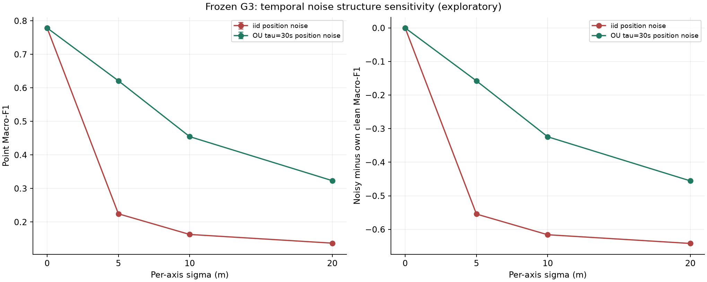
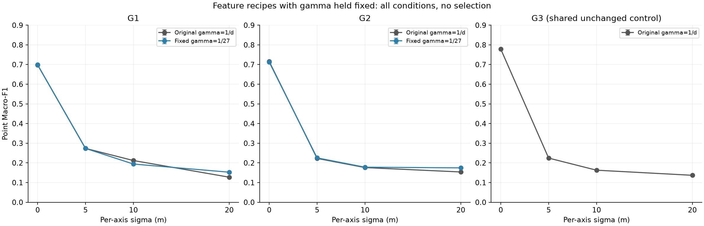
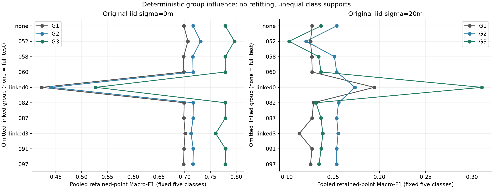
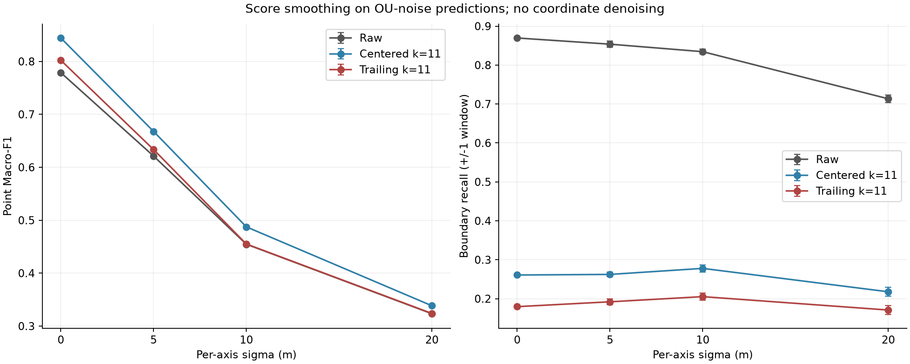

# 噪声主线：新增探索性实验

2026-11-23。AI辅助分析草稿，供团队核对、改写与引用。
本轮实际补跑相关噪声与固定gamma对照，并完成逐组排除分析。
原测试结果已提前看过：新增协议在本轮计算前固定，但不是预注册、
新独立测试验证或按测试结果选择模型。原主实验、原v2结果均保留。

## 1. 时间相关噪声：原结论对噪声结构有多敏感

沿原实际点间隔，在每个原block内生成平稳OU噪声；单轴sigma为
5/10/20m，相关时间tau=30s，五个原种子，E/N独立。
每个block重新取平稳初值；跨sigma共享标准场，且与原iid使用相同创新随机数。
噪声坐标后重新计算全部原运动量和窗口特征，不删除超速点。G3原冻结模型直接推理。

tau=30s只是一档预先固定的人工敏感性条件，不是GPS设备标定或“真实噪声模型”。
理论单轴边际SD相同，实际有限样本RMS原样记录、不归一化；相关过程的有效独立误差数更少。
更平滑的误差通常减小相邻误差增量，但本表给出的是实测模型结果，不由公式替代。

| sigma/m | iid raw F1 | OU raw F1±种子SD | OU noisy−clean | OU−iid | 差值用户组95%区间 |
| --- | --- | --- | --- | --- | --- |
| 0 | 0.7788 | 0.7788 ± 0.0000 | +0.0000 | +0.0000 | [+0.0000, +0.0000] |
| 5 | 0.2245 | 0.6212 ± 0.0012 | -0.1576 | +0.3967 | [+0.0577, +0.4511] |
| 10 | 0.1629 | 0.4546 ± 0.0012 | -0.3242 | +0.2917 | [-0.0200, +0.3230] |
| 20 | 0.1370 | 0.3234 ± 0.0012 | -0.4555 | +0.1864 | [-0.0968, +0.2097] |

正的OU−iid表示同一G3在这一合成相关结构下分数较高；
它不能证明某种现实GPS设备具有对应收益，更不能归结为模型执行了坐标去噪。
区间复用原5000次九关联组配对抽样，先逐种子计分再平均。
原clean只有一份，SD=0是CSV约定，未制造重复clean实验。

## 2. 固定gamma后再比较特征配方

在原70,086个clean拟合窗上新拟合G1/G2，gamma都设1/27。
中位数填补、标准化、1000维Nystroem、LinearSVC C=1 balanced、
seed42及其他配方不变。使用原16份iid特征缓存；G3复用原模型。

| 组 | sigma/m | 原gamma=1/d raw F1 | 固定gamma raw F1 | 固定gamma noisy−clean |
| --- | --- | --- | --- | --- |
| G1 | 0 | 0.6983 | 0.6986 | +0.0000 |
| G2 | 0 | 0.7163 | 0.7131 | +0.0000 |
| G1 | 5 | 0.2737 | 0.2736 | -0.4250 |
| G2 | 5 | 0.2228 | 0.2256 | -0.4874 |
| G1 | 10 | 0.2121 | 0.1942 | -0.5044 |
| G2 | 10 | 0.1763 | 0.1782 | -0.5349 |
| G1 | 20 | 0.1274 | 0.1528 | -0.5458 |
| G2 | 20 | 0.1539 | 0.1748 | -0.5383 |

这减少了比较中数值gamma同步变化的混杂，但输入维度、标准化距离和Nystroem表示仍会变化；
相同gamma不等于相同有效核宽度，更不是单独jerk/转向特征的因果消融。
全部条件与配对差见[summary](tables/summary.csv)、
[paired contrasts](tables/paired_contrasts.csv)，不据本次测试挑选“最优”配方。

## 3. 最大用户组影响：逐一排除九组

最大linked0组原占679,162/860,972点，即78.8832%。
依次排除每一原关联组，重算剩余点的固定五类F1，模型不重训。
下表重点显示全量与排除最大组；完整九组都在CSV保留。

| 组 | sigma/m | 排除组 | 保留点 | 真值类别数 | raw F1 | noisy−clean |
| --- | --- | --- | --- | --- | --- | --- |
| G1 | 0 | none | 860972 | 5 | 0.6983 | +0.0000 |
| G1 | 0 | linked0 | 181810 | 5 | 0.4227 | +0.0000 |
| G2 | 0 | none | 860972 | 5 | 0.7163 | +0.0000 |
| G2 | 0 | linked0 | 181810 | 5 | 0.4406 | +0.0000 |
| G3 | 0 | none | 860972 | 5 | 0.7788 | +0.0000 |
| G3 | 0 | linked0 | 181810 | 5 | 0.5275 | +0.0000 |
| G1 | 20 | none | 860972 | 5 | 0.1274 | -0.5709 |
| G1 | 20 | linked0 | 181810 | 5 | 0.1945 | -0.2282 |
| G2 | 20 | none | 860972 | 5 | 0.1539 | -0.5624 |
| G2 | 20 | linked0 | 181810 | 5 | 0.1737 | -0.2669 |
| G3 | 20 | none | 860972 | 5 | 0.1370 | -0.6418 |
| G3 | 20 | linked0 | 181810 | 5 | 0.3106 | -0.2168 |

不同排除集的用户和类别构成不同，分数变化不能全部归因于“某用户难”。
固定五类计分保留；每行的support_*、真值类别数、点数均输出。
九次排除共享绝大部分样本，不能当九次独立复现或新的置信区间。
另外输出各关联组固定五类指标等权平均，明确是描述性补充，不替代主点加权指标。

## 4. 分数平滑在相关噪声下的代价

| sigma/m | 平滑 | 点F1 | 边界召回 | 边界F1 |
| --- | --- | --- | --- | --- |
| 0 | S0_raw_k1 | 0.7788 | 0.8696 | 0.2596 |
| 0 | S1_centered_soft_k11 | 0.8443 | 0.2609 | 0.2754 |
| 0 | S2_trailing_soft_k11 | 0.8022 | 0.1796 | 0.1546 |
| 20 | S0_raw_k1 | 0.3234 | 0.7134 | 0.1847 |
| 20 | S1_centered_soft_k11 | 0.3384 | 0.2178 | 0.2124 |
| 20 | S2_trailing_soft_k11 | 0.3239 | 0.1709 | 0.1373 |

只平滑decision分数，不修改坐标。居中k=11用未来窗口，trailing只用当前与历史。
边界仍用窗口多数标签、同block内±1窗class-blind一对一最大匹配；
不把这一指标叫精确秒级实时切换能力。
clean只有529个边界，原5000个bootstrap抽样中133次无真边界，仍沿原零分母记0约定。
分类改善、少跳变和真实切换恢复必须分别讨论。

## 5. 证据边界与不足

本轮补的是明确的对照：人工噪声时间相关性、gamma同步变化、最大组影响。
它增加了对原结论适用范围的了解，不自动提高现实泛化能力。
没有新设备数据、新独立用户或按实际设备估计的误差过程。
tau只有30s一档；不代表全部时间相关噪声，更不覆盖多路径、偏置漂移、丢点或城市峡谷。
G1/G2/G3的原特征定义、signed acc_std和path_length/duration支持不一致仍保留。
raw基线1/17,380窗复现差异、混合标签窗口与粗粒度边界容差问题也没有被新实验消除。
未校正多重比较，区间只用于探索描述，不能据是否跨零宣称普遍排名。

全部新预测保留五类decision分数；模型、缓存与manifest均在本目录。
原144行指标逐项重算核对。自动验收与独立检查范围见
[验收](acceptance.json)、[独立验证](independent_verification.json)。
四张图提供PNG/PDF；自动布局与非空检查不等于完整目视审阅。

## 6. 可复现与来源

- [计算前固定的补充协议](PROTOCOL.md)
- [每种子完整指标](tables/all_seed_metrics.csv)、[逐用户](tables/per_user_metrics.csv)、
  [逐类F1](tables/per_class_f1.csv)
- [逐组排除全记录](tables/leave_one_group_out_seed.csv)、
  [逐组排除汇总](tables/leave_one_group_out_summary.csv)
- [输入哈希与软件版本](input_manifest.json)、[运行checkpoint](checkpoint.json)
- [原始文献访问记录](literature/retrieval.json)；原GPS论文阅读边界沿用
  [既有来源清单](../literature_review/SOURCES.md)。

OU公式依据Rasmussen与Williams《Gaussian Processes for Machine Learning》(2006)
第4章的指数协方差/OU过程；gamma依据scikit-learn Nystroem官方API。
流程使用scientific-critical-thinking技能，其软件引用为
Kassis等(2026), Scientific Agent Skills: A Library of Procedural Knowledge for
Research Agents, arXiv:2609.00065, DOI10.48550/arXiv.2609.00065。
该技能不是实验有效性的外部认证。
