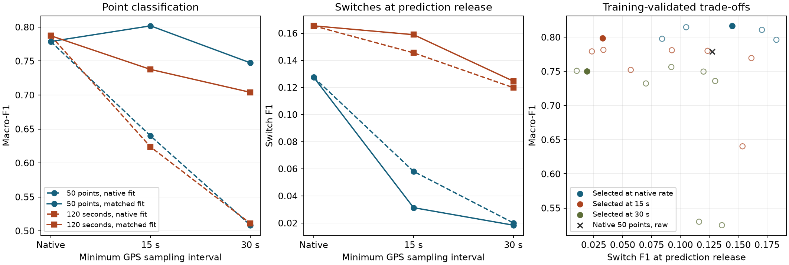

# GeoLife Part 3 joint experiment results

## Settings chosen by training-only validation

| Input | Window | Fitting samples | Smoother | Point macro-F1 | Release switch recall | Release switch F1 |
|---|---|---|---|---:|---:|---:|
| Native | t120 | Native | past300s | 0.8167 | 0.2994 | 0.1449 |
| 15 s | p50 | 15 s | past600s | 0.7986 | 0.0258 | 0.0328 |
| 30 s | p50 | 30 s | past600s | 0.7500 | 0.0122 | 0.0192 |

| Input | Macro-F1 change vs same-rate native-trained 50-point raw | Release switch F1 change |
|---|---:|---:|
| Native | +0.0379 [+0.0071, +0.0554] | +0.0174 [+0.0041, +0.1075] |
| 15 s | +0.1588 [-0.0035, +0.1831] | -0.0253 [-0.0299, +0.0000] |
| 30 s | +0.2416 [+0.0041, +0.2533] | -0.0009 [-0.0048, +0.0119] |

## Configurations for switch detection

This exploratory comparison selects the highest mean release switch F1 on the training folds without a classification constraint, using mean macro-F1 to break ties. The table gives test results for these training-fold choices.

| Input | Window | Fitting interval (s) | Smoother | Point macro-F1 | Release switch F1 |
|---|---|---:|---|---:|---:|
| Native | t60 | 0 | past3 | 0.7963 | 0.1831 |
| 15 s | t120 | 0 | past120s | 0.6403 | 0.1538 |
| 30 s | t120 | 0 | past120s | 0.5249 | 0.1360 |

## Short-window compromise for thinned input

This supplementary analysis restricts the candidate set to 120-second windows. It applies the same 0.02 classification margin and switch-F1 rule to training folds. The window restriction was motivated by the release delays observed in the main analysis.

| Input | Fitting interval (s) | Smoother | Point macro-F1 | Release switch F1 |
|---|---:|---|---:|---:|
| 15 s | 15 | past300s | 0.7801 | 0.1236 |
| 30 s | 30 | past600s | 0.7564 | 0.0922 |

## Main comparisons

- The native 50-point reference gives macro-F1 0.7788 raw and 0.8442 with centered 11-window smoothing. Switch recall under original-label timing changes from 0.6064 to 0.1353. The centered policy uses future scores.
- Point-level classification uses the same original 860,972 test points in each condition.
- A release switch is a change in the prediction as new window scores become available during a replay. The replay assumes known block termination. Switch recall and classification on the retrospective timeline use window starts. Switch matching has a 120-second tolerance and does not require class agreement.

| Input | Test fixes kept | Native-trained 50-point raw F1 | Native-trained 120-second raw F1 | Difference with paired 95% interval |
|---|---:|---:|---:|---:|
| Native | 100.0% | 0.7788 | 0.7873 | +0.0085 [-0.0286, +0.0154] |
| 15 s | 14.3% | 0.6398 | 0.6236 | -0.0162 [-0.0808, -0.0045] |
| 30 s | 7.6% | 0.5084 | 0.5110 | +0.0026 [-0.0405, +0.0191] |

Paired intervals resample nine linked user groups 5,000 times. The comparison table contains descriptive estimates for this split. Fixed-duration windows use a different minimum fitting-point rule.

## Point classification at prediction release

Each point uses the most recently released prediction in its block. Coverage is the fraction of points with an available prediction. The all-point accuracy counts abstentions as incorrect. Scores on covered points use a subset that can differ across settings.

| Input | Window | Fitting interval (s) | Smoother | Median window start to release (s) | Coverage | Covered macro-F1 | All-point accuracy |
|---|---|---:|---|---:|---:|---:|---:|
| Native | p50 | 0 | raw | 148 | 91.2% | 0.7666 | 0.7187 |
| 15 s | p50 | 0 | raw | 1180 | 51.0% | 0.4844 | 0.2690 |
| 30 s | p50 | 0 | raw | 1680 | 31.3% | 0.3602 | 0.1488 |
| Native | t120 | 0 | past300s | 120 | 94.2% | 0.7946 | 0.7647 |
| 15 s | p50 | 15 | past600s | 1180 | 51.0% | 0.6177 | 0.3217 |
| 30 s | p50 | 30 | past600s | 1680 | 31.3% | 0.5107 | 0.1802 |
| Native | t60 | 0 | past3 | 60 | 97.0% | 0.7849 | 0.7869 |
| 15 s | t120 | 0 | past120s | 112 | 94.2% | 0.6180 | 0.6351 |
| 30 s | t120 | 0 | past120s | 109 | 94.2% | 0.5059 | 0.5565 |
| 15 s | t120 | 15 | past300s | 112 | 94.2% | 0.7591 | 0.7493 |
| 30 s | t120 | 30 | past600s | 109 | 94.2% | 0.7302 | 0.7184 |

See `factor_contrasts.csv` for paired sampling, window, and retraining comparisons, `paired_bootstrap.csv` for the selected policies against the references, and `test_metrics.csv` for the full exploratory grid. `validation_frontier.csv` lists settings that no alternative outscored on both validation objectives for their input rate. Open markers in the third plot show their test results. `training_support.csv` documents training support by setting.

